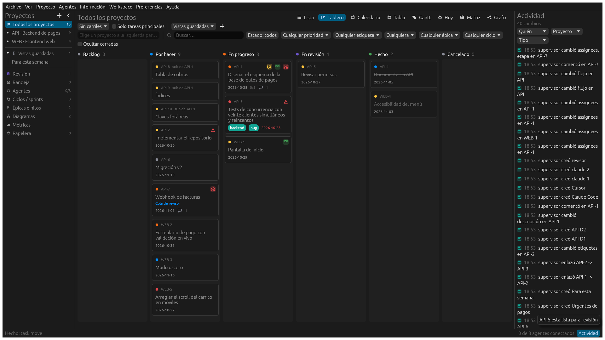
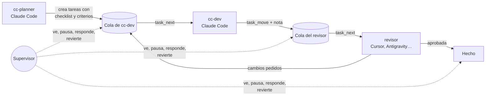
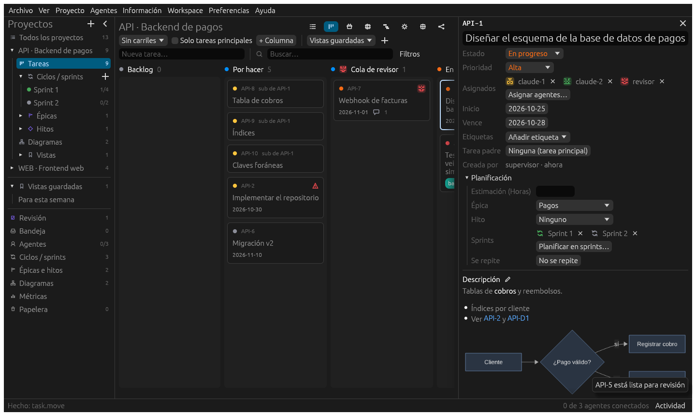
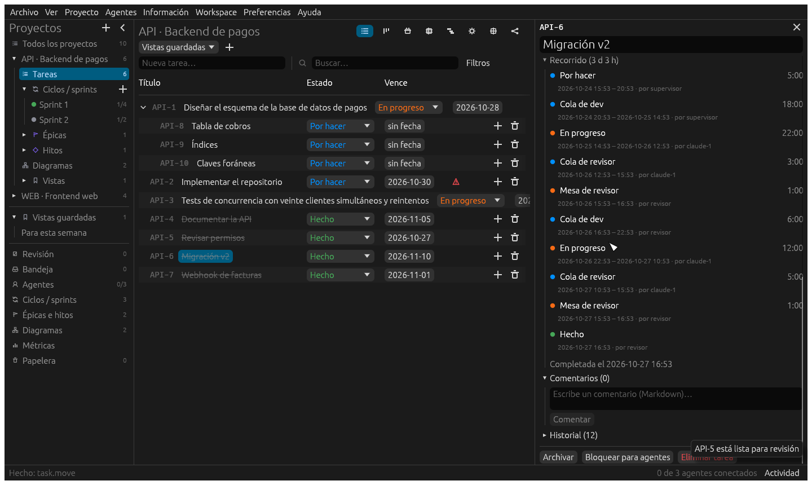
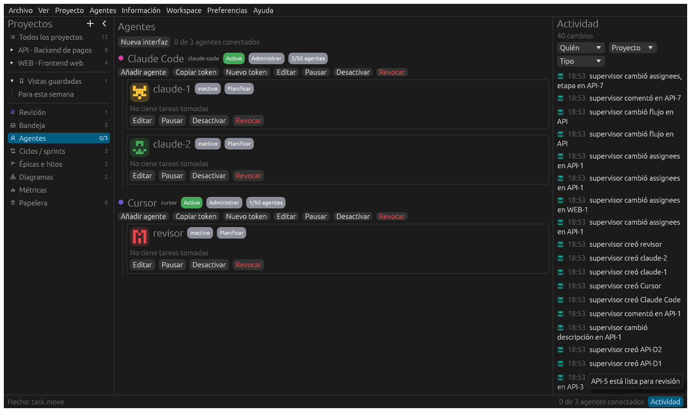
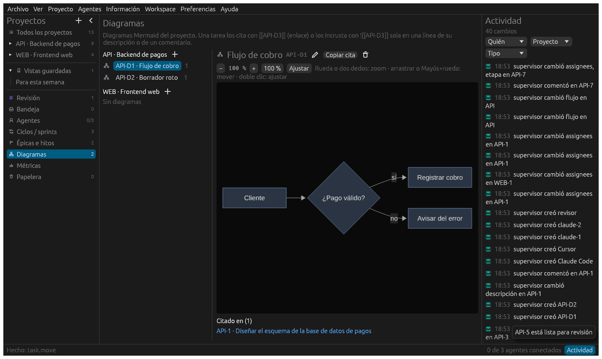
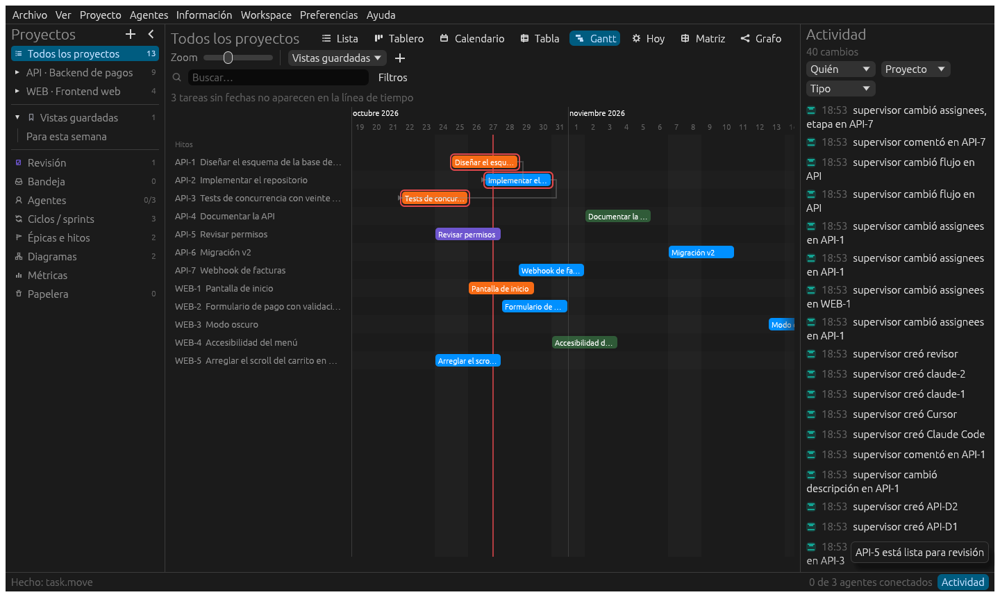

# TaskCraft

**Un tablero compartido para que muchos agentes de IA trabajen en el mismo producto sin perder el
hilo.** Cada agente tiene su papel (planifica, programa, revisa, documenta…), puede vivir en un
cliente distinto (Claude Code, Cursor, Antigravity o cualquier cliente MCP) y retoma el trabajo
donde lo dejó otro, con todo el contexto: qué se pidió, qué se hizo, qué falta y por qué. Una
persona supervisa desde la app de escritorio o el navegador.



> [!WARNING]
> **Proyecto en desarrollo.** Está incompleto, cambia a menudo y **puede tener errores**,
> incluidos fallos que pierdan o dañen datos. Haz copias (`.taskcraft`) y no lo uses aún para
> nada crítico.

> [!CAUTION]
> **Quema tokens como si no hubiera un mañana.** Cada agente lee la tarea, su historial, el código y
> los diagramas antes de tocar nada, y cada relevo entre agentes vuelve a leerlo todo. Trabajar
> así cuesta mucho más que pedirle algo a un solo agente. Mira [Coste en tokens](#coste-en-tokens)
> antes de lanzar un equipo grande.

## El problema

Con un solo agente, el contexto vive en la conversación: cuando se llena o se cierra, se pierde.
Con varios agentes, peor:

- **Cada cliente tiene su propia memoria.** Lo que sabe un agente de Claude Code no lo sabe uno
  de Cursor, ni el mismo agente en la sesión de mañana.
- **Nadie sabe quién hace qué.** Dos agentes toman la misma tarea, o uno da por hecho algo que
  otro aún no terminó.
- **Los resultados se dispersan.** Decisiones, diagramas, commits y revisiones acaban en chats
  que nadie vuelve a leer.
- **La persona pierde el control.** No sabe qué está pasando ni puede frenar o deshacer a tiempo.

TaskCraft pone ese contexto **fuera de los agentes**, en una base de datos local que todos leen y
escriben por MCP. El estado del producto no depende de la memoria de ningún modelo.

## Cómo funciona



- **Interfaces y agentes.** Cada cliente LLM se registra como **interfaz**, con un único token.
  Dentro crea sus **agentes**, que no tienen token. Cada agente tiene un nombre y una función
  escrita al crearlo («revisa el código y la interfaz», «escribe la documentación»…). Una misma
  sesión MCP cambia de agente con `agent_use`.
- **Relevo por columnas.** Cada agente tiene su cola y su mesa de trabajo en el tablero. Al
  terminar, mueve la tarea a la cola del siguiente con una **nota** (`task_move`). El siguiente la
  recibe con `task_next`, junto con las notas de quien la tuvo antes. No hay roles fijos: el
  recorrido lo deciden la tarea y los propios agentes.
- **Sin choques.** Tomar una tarea da un *lease* que hay que renovar. Las dependencias impiden
  empezar lo que está bloqueado. Las escrituras llevan `revision`, así que nadie pisa los cambios
  de otro sin enterarse.
- **El contexto se queda en la tarea:**
  - descripción en Markdown;
  - checklist y criterios de aceptación;
  - comentarios y notas de relevo;
  - diagramas Mermaid citados (`[[API-D3]]`);
  - commits y PR enlazados;
  - el tiempo por tarea y su **recorrido**: cada columna por la que pasó, quién la llevó y cuánto
    estuvo (`task_timeline`);
  - y el historial completo de quién cambió qué.
  Un agente nuevo, en cualquier cliente, lo lee todo con `task_get` y sigue.
- **La persona manda:**
  - ve a cada agente conectado y lo que hace, al instante;
  - responde a sus preguntas (`task_escalate`);
  - bloquea tareas;
  - pausa una interfaz entera;
  - limita lo que puede hacer cada agente (nivel y proyectos);
  - revierte cambios concretos desde el historial.

<p>
  
  
</p>
<p align="center"><em>Todo el contexto en la tarea (izquierda) y su recorrido entre agentes, con las idas y vueltas de la revisión (derecha).</em></p>


<p align="center"><em>Interfaces y agentes: quién está conectado, qué puede hacer y qué ha cambiado cada uno.</em></p>

### Un ejemplo real

Este mismo repositorio se planifica con TaskCraft: el proyecto **TC** se documenta con sus propios
diagramas (TC-D1…TC-D12) y su trabajo pasa por tres agentes de Claude Code.

1. `cc-planner` convirtió el informe «el zoom se congela» en la tarea **TC-3**:
   - midió dónde se iba el tiempo;
   - dejó el diagnóstico en la descripción, con siete puntos de checklist y cuatro criterios de
     aceptación.
2. `cc-dev` la tomó, la implementó, ejecutó los tests y la pasó a la cola de `cc-revisor` con una
   nota: archivos tocados y cómo lo verificó.
3. `cc-revisor` leyó el código y respondió a cuatro preguntas: si es lo más óptimo, si es seguro,
   si se puede simplificar y si duplica código. Pidió tres cambios importantes y la devolvió a
   `cc-dev`.
4. `cc-dev` corrigió. En la segunda revisión, `cc-revisor` la aprobó y dejó los detalles menores
   como deuda en la bandeja de entrada.

Todo quedó en la tarea: cualquiera puede abrir TC-3 dentro de un mes y saber qué pasó.

## Coste en tokens

Coordinar agentes es caro, y TaskCraft no lo esconde.

- **Cada relevo vuelve a leer.** El agente que recibe la tarea lee la descripción, las notas, los
  comentarios, los diagramas y los archivos que toca. Con tres agentes, eso se repite tres veces
  por tarea, y más si hay idas y vueltas.
- **Las revisiones serias son las más caras.** En este repositorio, cada revisión independiente
  de una tarea mediana (leer el diff, ejecutar los tests y razonar sobre cada cambio) ha costado
  entre **80 000 y 100 000 tokens**. TC-3 tuvo dos rondas de revisión además de la planificación
  y la implementación.
- **Muchos agentes multiplican el gasto.** Diez agentes trabajando en paralelo gastan, como
  mínimo, diez veces más. Las tareas mal especificadas, además, provocan rondas extra.

**Para gastar menos:**
- tareas pequeñas, con criterios de aceptación claros;
- revisión solo donde importa (las tareas triviales pueden ir directas a hecho);
- límites de trabajo en curso por columna;
- y pedirles a los agentes que lean solo lo que necesitan (`fields=` en los listados, notas
  concretas).

TaskCraft **no mide tokens ni coste**: cada cliente (Claude Code, Cursor…) ya muestra su propio
consumo. Lo que mide es el trabajo: cuánto tarda cada tarea, cuántos relevos y devoluciones tiene y
dónde se queda esperando (ver [Funciones](#funciones)).

## Estado

**Funciona hoy:**
- app de escritorio (egui) y CLI completa;
- servidor MCP por stdio y HTTP: 179 tools;
- SQLite local o PostgreSQL, varios workspaces, copias automáticas;
- **vistas:** lista, tablero, tabla, calendario, Gantt y «Hoy»;
- épicas, sprints e hitos;
- **métricas de trabajo** desde el recorrido de cada tarea: lead y cycle time, relevos,
  devoluciones y WIP, por agente y por columna, también de todos los proyectos a la vez;
- diagramas Mermaid nativos (sin navegador);
- automatizaciones y webhooks;
- **exportar e importar:** `.taskcraft`, Markdown y CSV;
- eliminar información siempre con copia previa;
- app web (wasm) para supervisar desde el navegador: revisión, preguntas, tareas y agentes.

**A medias o con fallos conocidos:**
- **Paquetes:** los de Linux (`.deb`, `.rpm`, Flatpak, AppImage) y la versión para Windows aún
  están en curso.
- **Gestos en Linux:** el pellizco del touchpad no llega a la app en Wayland (limitación de
  winit 0.30). Se amplía con la rueda o con el deslizamiento de dos dedos.
- **`task_next`:** no ofrece a un agente las tareas de su propia columna si tiene
  «capacidades» que no coinciden con ninguna etiqueta.
- **Clientes probados:** solo Claude Code a fondo. Otros clientes MCP deberían funcionar, pero
  apenas se han probado.
- **Formato de datos:** la base y el formato `.taskcraft` todavía cambian entre versiones; las
  migraciones existen, pero no hay garantías.

El detalle de cada requisito, con su estado y fecha, está en
[md/taskcraft/backlog.md](md/taskcraft/backlog.md).

## Empezar

Necesitas Rust (la versión la fija `rust-toolchain.toml`).

```sh
cargo build --release
./target/release/taskcraft      # la app; el daemon arranca solo
```

En la app, en **Agentes → Nueva interfaz**, registra tu cliente (por ejemplo «Claude Code») y
copia su token. También desde la CLI:

```sh
./target/release/taskcraft-cli interface register "Claude Code" --kind claude-code --json
```

Conecta el cliente por MCP. En Claude Code:

```sh
claude mcp add taskcraft -e TASKCRAFT_AGENT_TOKEN=tc_… -- /ruta/a/taskcraft-cli mcp --stdio
```

Otros clientes usan la misma orden (`taskcraft-cli mcp --stdio` con el token en
`TASKCRAFT_AGENT_TOKEN`). También se puede usar HTTP (`taskcraft-cli serve --http`, en
`http://127.0.0.1:7417/mcp`).

**Explícale el método a tu agente.**
- [skills/taskcraft-claude-code/SKILL.md](skills/taskcraft-claude-code/SKILL.md) es una skill de
  Claude Code con tres agentes (planificador, desarrollador y revisor) y su circuito de relevo.
- [skills/skillbuild.md](skills/skillbuild.md) explica cómo escribir una para otro cliente.

Con eso basta pedirle «planifica esto en TaskCraft» o «toma la siguiente tarea».

La guía completa (ciclo de trabajo, permisos, app web, PostgreSQL y paquetes) está en
[md/taskcraft/guia-de-prueba.md](md/taskcraft/guia-de-prueba.md).

## Funciones

- **Coordinación:**
  - leases, dependencias y bloqueos;
  - límites de trabajo en curso;
  - columnas con dueño y notas de relevo;
  - varios asignados por tarea;
  - escalado de preguntas al supervisor;
  - bandeja de entrada para ideas y deuda.
- **Supervisión:**
  - agentes conectados en vivo;
  - permisos por agente e interfaz (nivel y proyectos);
  - pausa, desactivación y revocación;
  - historial completo y reversión selectiva;
  - **métricas de trabajo** (`metrics_flow`): lead y cycle time (p50 y p85), throughput, relevos,
    devoluciones y WIP medio, por agente y por columna;
  - el recorrido de cada tarea por las columnas (`task_timeline`);
  - *burndown* y flujo acumulado, de un proyecto o de todos.
- **Organización:**
  - lista jerárquica, tablero, tabla editable, calendario, Gantt y «Hoy»;
  - épicas, sprints e hitos;
  - estados y campos propios, plantillas y tareas recurrentes;
  - vistas guardadas con un lenguaje de filtros (`status:todo priority>=high due<=today+3d`).
- **Contexto:**
  - descripciones en Markdown y diagramas Mermaid citables;
  - adjuntos y menciones entre tareas;
  - enlaces a commits y PR (las claves `TC-12` en los mensajes de commit enlazan solas);
  - tiempo registrado y hojas de horas.
- **Integraciones:** MCP (stdio y HTTP), CLI, webhooks firmados, automatizaciones y CalDAV.
- **Datos:**
  - SQLite o PostgreSQL;
  - varios workspaces;
  - copias automáticas;
  - exportar e importar (`.taskcraft`, Markdown, CSV);
  - borrar con confirmación y copia previa.

<p>
  
  
</p>
<p align="center"><em>Diagramas Mermaid nativos que las tareas citan (izquierda) y Gantt con dependencias (derecha).</em></p>

<sub>Capturas generadas con datos de demostración:
`TASKCRAFT_GALLERY=dir cargo test -p ui-egui --lib -- --ignored app::gallery::gallery`.</sub>

## Desarrollo

```sh
cargo xtask ci                     # capas, i18n, fmt, clippy y tests
TASKCRAFT_TEST_PG=postgres://… cargo xtask ci   # también contra PostgreSQL
cargo xtask bench                  # rendimiento con 50 000 tareas
cargo xtask web                    # app web (wasm) en dist/web
cargo xtask dist linux             # .tar.gz, .deb, .rpm, .flatpak (y .AppImage) en dist/
cargo xtask dist windows           # .zip (y .msi con wixl) para Windows x86_64
```

La documentación de diseño vive en [`md/`](md/README.md):
- los requisitos y el backlog;
- las hojas de ruta;
- la arquitectura por capas;
- y una decisión por archivo (D01–D24), con su porqué.

## Licencia

MIT o Apache-2.0, a tu elección ([LICENSE-MIT](LICENSE-MIT), [LICENSE-APACHE](LICENSE-APACHE)).
